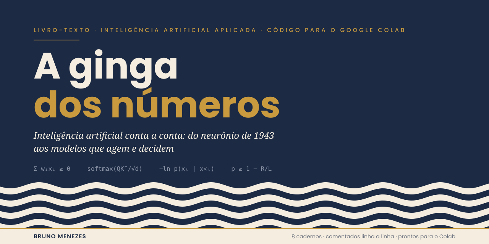
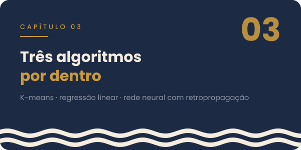
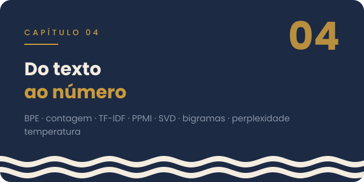
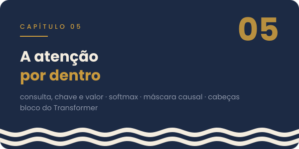
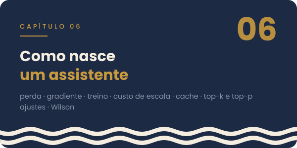
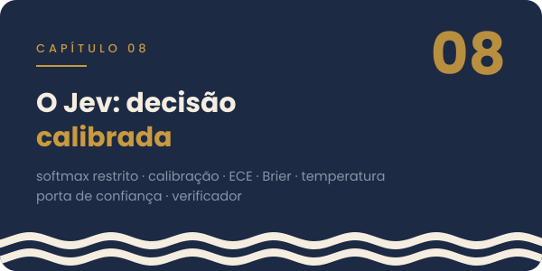

<p align="center">
  
</p>

<p align="center">
  
  
  
  <a href="LICENSE"></a>
  <a href="https://doi.org/10.5281/zenodo.24277459"></a>
</p>

<br>

> **Na capoeira, a ginga é o movimento de base:** nunca parado, sempre pronto para responder ao outro. Neste livro, a ginga é a dos números. Somar, multiplicar, comparar e corrigir, de novo e de novo, até que uma máquina pareça entender.

Este repositório reúne os notebooks do **livro de exercícios** que acompanha o livro-texto *A ginga dos números: inteligência artificial conta a conta*, de Bruno Menezes.

Cada caderno refaz em Python, passo a passo, os exemplos numéricos de um capítulo do livro-texto. Todo o código está **comentado linha a linha**, pensando em quem nunca programou. Os números que aparecem na tela devem ser os mesmos do livro.

<p align="center"></p>

## Os capítulos

Basta uma conta Google: nada é instalado e nada é pago. Clique no cartão do capítulo para abri-lo no **Google Colab** e depois em **Arquivo, Salvar uma cópia no Drive** para guardar as suas alterações.

<table>
  <tr>
    <td width="50%" valign="top">
      <a href="https://colab.research.google.com/github/brunoleomenezes/ginga-dos-numeros/blob/main/cap01/cap01_evolucao_da_ia.ipynb"></a>
      <p align="center">
        <a href="https://colab.research.google.com/github/brunoleomenezes/ginga-dos-numeros/blob/main/cap01/cap01_evolucao_da_ia.ipynb"></a>
        <a href="cap01/cap01_evolucao_da_ia.py"></a>
      </p>
    </td>
    <td width="50%" valign="top">
      <a href="https://colab.research.google.com/github/brunoleomenezes/ginga-dos-numeros/blob/main/cap02/cap02_o_que_e_ia.ipynb"></a>
      <p align="center">
        <a href="https://colab.research.google.com/github/brunoleomenezes/ginga-dos-numeros/blob/main/cap02/cap02_o_que_e_ia.ipynb"></a>
        <a href="cap02/cap02_o_que_e_ia.py"></a>
      </p>
    </td>
  </tr>
  <tr>
    <td width="50%" valign="top">
      <a href="https://colab.research.google.com/github/brunoleomenezes/ginga-dos-numeros/blob/main/cap03/cap03_tres_algoritmos.ipynb"></a>
      <p align="center">
        <a href="https://colab.research.google.com/github/brunoleomenezes/ginga-dos-numeros/blob/main/cap03/cap03_tres_algoritmos.ipynb"></a>
        <a href="cap03/cap03_tres_algoritmos.py"></a>
      </p>
    </td>
    <td width="50%" valign="top">
      <a href="https://colab.research.google.com/github/brunoleomenezes/ginga-dos-numeros/blob/main/cap04/cap04_do_texto_ao_numero.ipynb"></a>
      <p align="center">
        <a href="https://colab.research.google.com/github/brunoleomenezes/ginga-dos-numeros/blob/main/cap04/cap04_do_texto_ao_numero.ipynb"></a>
        <a href="cap04/cap04_do_texto_ao_numero.py"></a>
      </p>
    </td>
  </tr>
  <tr>
    <td width="50%" valign="top">
      <a href="https://colab.research.google.com/github/brunoleomenezes/ginga-dos-numeros/blob/main/cap05/cap05_a_atencao_por_dentro.ipynb"></a>
      <p align="center">
        <a href="https://colab.research.google.com/github/brunoleomenezes/ginga-dos-numeros/blob/main/cap05/cap05_a_atencao_por_dentro.ipynb"></a>
        <a href="cap05/cap05_a_atencao_por_dentro.py"></a>
      </p>
    </td>
    <td width="50%" valign="top">
      <a href="https://colab.research.google.com/github/brunoleomenezes/ginga-dos-numeros/blob/main/cap06/cap06_como_nasce_um_assistente.ipynb"></a>
      <p align="center">
        <a href="https://colab.research.google.com/github/brunoleomenezes/ginga-dos-numeros/blob/main/cap06/cap06_como_nasce_um_assistente.ipynb"></a>
        <a href="cap06/cap06_como_nasce_um_assistente.py"></a>
      </p>
    </td>
  </tr>
  <tr>
    <td width="50%" valign="top">
      <a href="https://colab.research.google.com/github/brunoleomenezes/ginga-dos-numeros/blob/main/cap07/cap07_agentes.ipynb"></a>
      <p align="center">
        <a href="https://colab.research.google.com/github/brunoleomenezes/ginga-dos-numeros/blob/main/cap07/cap07_agentes.ipynb"></a>
        <a href="cap07/cap07_agentes.py"></a>
      </p>
    </td>
    <td width="50%" valign="top">
      <a href="https://colab.research.google.com/github/brunoleomenezes/ginga-dos-numeros/blob/main/cap08/cap08_jev_decisao_calibrada.ipynb"></a>
      <p align="center">
        <a href="https://colab.research.google.com/github/brunoleomenezes/ginga-dos-numeros/blob/main/cap08/cap08_jev_decisao_calibrada.ipynb"></a>
        <a href="cap08/cap08_jev_decisao_calibrada.py"></a>
      </p>
    </td>
  </tr>
</table>

<sub>O Capítulo 9, de considerações finais, não tem lista de exercícios.</sub>

<p align="center"></p>

## Como estudar com estes cadernos

| | |
| :---: | --- |
| **01** | Leia o capítulo no livro-texto e refaça os exemplos com a calculadora, prevendo o resultado antes de olhar a resposta. |
| **02** | Abra o caderno do capítulo e **digite** o código em um caderno seu, em vez de copiar: digitar é o que ensina. Use este caderno, que já traz as saídas, para conferir. |
| **03** | Execute as células **na ordem**: quase todas dependem das anteriores. Se algo der errado, use *Ambiente de execução, Reiniciar sessão e executar tudo*. |
| **04** | Responda aos blocos **Sua vez** em células de texto, com as suas palavras. |

## Estrutura

```
ginga-dos-numeros/
├── README.md
├── requirements.txt
├── assets/                          (identidade visual do repositório)
├── cap01/
│   ├── cap01_evolucao_da_ia.ipynb   (caderno executado, com as saídas)
│   └── cap01_evolucao_da_ia.py      (mesmo código, em script)
├── cap02/
│   ├── cap02_o_que_e_ia.ipynb   (caderno executado, com as saídas)
│   └── cap02_o_que_e_ia.py      (mesmo código, em script)
├── cap03/
│   ├── cap03_tres_algoritmos.ipynb   (caderno executado, com as saídas)
│   └── cap03_tres_algoritmos.py      (mesmo código, em script)
├── cap04/
│   ├── cap04_do_texto_ao_numero.ipynb   (caderno executado, com as saídas)
│   └── cap04_do_texto_ao_numero.py      (mesmo código, em script)
├── cap05/
│   ├── cap05_a_atencao_por_dentro.ipynb   (caderno executado, com as saídas)
│   └── cap05_a_atencao_por_dentro.py      (mesmo código, em script)
├── cap06/
│   ├── cap06_como_nasce_um_assistente.ipynb   (caderno executado, com as saídas)
│   └── cap06_como_nasce_um_assistente.py      (mesmo código, em script)
├── cap07/
│   ├── cap07_agentes.ipynb   (caderno executado, com as saídas)
│   └── cap07_agentes.py      (mesmo código, em script)
└── cap08/
    ├── cap08_jev_decisao_calibrada.ipynb   (caderno executado, com as saídas)
    └── cap08_jev_decisao_calibrada.py      (mesmo código, em script)
```

Os arquivos `.py` usam o formato de células `# %%`: abrem como caderno no VS Code e no Spyder, e rodam inteiros com `python capNN_....py`.

## Rodar no próprio computador (opcional)

```bash
pip install -r requirements.txt
python cap01/cap01_evolucao_da_ia.py
```

Todos os cadernos foram executados do início ao fim, sem erros, com Python 3.13, NumPy 2.5, SciPy 1.18, scikit-learn 1.9 e matplotlib 3.11. Em versões diferentes, alguns números podem variar na última casa decimal.

## Como citar

O material está arquivado no **Zenodo**, com identificador permanente (DOI):

<p>
  <a href="https://doi.org/10.5281/zenodo.24277459"></a>
</p>

```bibtex
@misc{menezes2026ginga,
  author    = {Menezes, Bruno},
  title     = {A ginga dos números: inteligência artificial conta a conta},
  year      = {2026},
  publisher = {Zenodo},
  doi       = {10.5281/zenodo.24277459},
  url       = {https://doi.org/10.5281/zenodo.24277459}
}
```

<p align="center"></p>

## Autor

**Bruno Menezes**

<p>
  <a href="https://brunoleomenezes.github.io/"></a>
  <a href="http://lattes.cnpq.br/7671983530035555"></a>
  <a href="https://orcid.org/0000-0001-6249-2395"></a>
</p>

O cenário da empresa ServiPro Soluções Administrativas, usado nos exemplos, é fictício.

<p align="center"></p>
